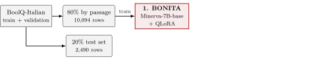
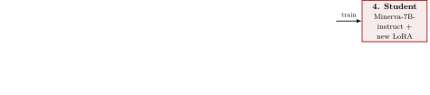
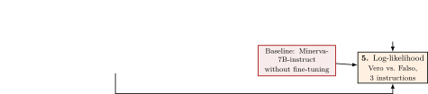
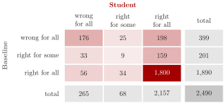

## {.beamer-title}

::: titlebox
[BONITA: Generating Italian Instruction-Tuning Data for Boolean Question Answering]{.t1}
[3-cfu Project Work in Natural Language Processing]{.t2}
:::

[Francesco Baiocchi, Leonardo Petrilli]{.who}
[Supervisor: Prof. Paolo Torroni]{.prof}
[Master's Degree in Artificial Intelligence, University of Bologna]{.where}
[Fall 2026]{.when}

## Our question

- Teaching an LLM a task needs annotated examples, and in Italian they are scarce, while raw Italian text is everywhere
- Bonito (Nayak et al., 2024) showed that a model can learn to turn a raw passage into a task with its answer, and that training on such tasks adapts an LLM better than training on the raw text

::: block
::: block-title
What we wanted to know
:::
::: block-body
Does this work for Italian? We built **BONITA**, a generator that reads an Italian paragraph and writes a yes/no question about it with its answer, `Vero` or `Falso`.

[Does training only on BONITA's questions make the model better on a test set of human-labeled Italian questions?]{.hl}
:::
:::

We train BONITA, use it to generate questions from Wikipedia, fine-tune a student on these questions only, and compare it with the original model.

## What we built {.pipeline}

```{=html}
<div class="r-stack pipeline-fig">




</div>
<ul class="pipeline-steps">
<li class="fragment pipe-text" data-fragment-index="1"><strong>Training BONITA</strong>: on 80% of BoolQ-Italian, split by paragraph, Minerva-7B-base learns with QLoRA, about 42M trainable parameters (0.6%), to write a question about a passage and its answer, <code>Vero</code> or <code>Falso</code></li>
<li class="fragment pipe-text" data-fragment-index="2"><strong>Generation</strong>: BONITA writes one question for each of 10,000 unlabeled Italian Wikipedia paragraphs, and <span class="hl">9,964</span> of them are usable</li>
<li class="fragment pipe-text" data-fragment-index="3"><strong>Training the student</strong>: a new QLoRA adapter on Minerva-7B-instruct, trained only on the synthetic dataset, so that it learns the task only from data written by BONITA</li>
<li class="fragment pipe-text" data-fragment-index="4"><strong>Evaluation</strong>: the student and the <strong>baseline</strong>, Minerva-7B-instruct without fine-tuning, answer the 2,490 questions of the test set, from BoolQ-Italian in ITA-Bench (Moroni et al., 2024)</li>
</ul>
```

## How BONITA is trained: Bonito's meta-template {.meta .top}

:::: {.columns}
::: {.column width="46%"}
```text
Prompt:
<|tasktype|>
boolean question answering
<|context|>
{passage}
<|task|>

Completion:
{instruction} {question} Vero o Falso?
<|pipe|>
Risposta: Vero/Falso
```
:::
::: {.column width="54%"}
- The prompt, task type and passage, is only the input: BONITA is trained to write the completion, that is the instruction, the question, `<|pipe|>` and the answer. As in Bonito, the loss is computed on the completion only
- The four markers are new special tokens, each a single token; their embedding rows are trained together with the LoRA weights
- BoolQ questions come without an instruction, so we add one, drawn at random from three different Italian wordings: with a single wording, BONITA would start every task with the same sentence
:::
::::

## What BONITA writes {.compact}

::: block
::: block-title
A Wikipedia paragraph, never labeled by anyone
:::
::: block-body
*"Glux-en-Glenne si trova sul massiccio del Morvan ed è il comune più alto del dipartimento con il Monte Préneley culminante a 855 m s.l.m., sulle cui falde vi sono le sorgenti che danno origine al fiume Yonne."*
:::
:::

::: block
::: block-title
The task BONITA generates from it
:::
::: block-body
*"In base al testo precedente, rispondi alla domanda: La sorgente del fiume Yonne si trova nel Morvan? Vero o Falso?"* → **Vero**

The answer is in the paragraph alone: Glux-en-Glenne is on the Morvan, and the sources of the Yonne are on the slopes of its Monte Préneley.
:::
:::

BONITA almost always writes a well-formed task: of 10,000 generations, only 4 are malformed and 32 repeat a question already kept, so [9,964 (99.6%)]{.hl} are kept.

## How we evaluate {.meta}

:::: {.columns}
::: {.column width="46%"}
```text
Prompt:
{passage}

{instruction} {question} Vero o Falso?
Risposta:

Scored continuations:
 Vero    log P( Vero | prompt)
 Falso   log P( Falso | prompt)
```
:::
::: {.column width="54%"}
- The model reads the prompt and we compare the log-probability of ` Vero` and ` Falso`: the more likely one is its answer, so no free-text answer has to be parsed
- Each of the 2,490 test questions is scored three times, once with each instruction; the next slide reports each instruction and their mean
- Same model, same prompts: the **baseline** is Minerva-7B-instruct as it is, the **student** is the same model fine-tuned on BONITA's data only, so any difference is due to the fine-tuning
- We report accuracy and macro-F1 because the classes are unbalanced: 61.0% of the test questions are `Vero`, so a model that always answers `Vero` already reaches 61.0 accuracy
:::
::::

## The synthetic data improves the model

<table class="booktabs">
<thead>
<tr><th class="left">Model</th><th>Instr.</th><th>Accuracy</th><th>Macro-F1</th></tr>
</thead>
<tbody>
<tr><td class="left">Always <code>Vero</code></td><td>–</td><td>61.0</td><td>37.9</td></tr>
<tr class="mid"><td class="left" rowspan="4">Baseline</td><td>0</td><td>79.7</td><td>79.4</td></tr>
<tr><td>1</td><td>81.1</td><td>80.9</td></tr>
<tr><td>2</td><td>79.6</td><td>79.4</td></tr>
<tr class="end"><td>mean</td><td>80.1</td><td>79.9</td></tr>
<tr class="mid"><td class="left" rowspan="4">Student</td><td>0</td><td>88.2</td><td>87.6</td></tr>
<tr><td>1</td><td>87.7</td><td>87.3</td></tr>
<tr><td>2</td><td>88.2</td><td>87.7</td></tr>
<tr><td>mean</td><td><strong>88.0</strong></td><td><strong>87.5</strong></td></tr>
</tbody>
</table>

- The baseline is already instruction-tuned and well above always answering `Vero`: the gain comes on top of instruction tuning, from fewer than 10,000 synthetic examples
- The gain holds with each of the three instructions, and the student varies less with the wording: its accuracy ranges from 87.7 to 88.2, the baseline's from 79.6 to 81.1

## The gain is on the `Vero` questions, and not just a bias

<table class="booktabs">
<thead>
<tr><th class="left">Model</th><th>Instr.</th><th>Pred. <code>Vero</code></th><th>Recall <code>Vero</code></th><th>Recall <code>Falso</code></th></tr>
</thead>
<tbody>
<tr><td class="left" rowspan="4">Baseline</td><td>0</td><td>50.8</td><td>75.0</td><td>87.0</td></tr>
<tr><td>1</td><td>50.8</td><td>76.2</td><td>88.8</td></tr>
<tr><td>2</td><td>48.0</td><td>72.7</td><td>90.4</td></tr>
<tr class="end"><td>mean</td><td>49.9</td><td>74.6</td><td>88.8</td></tr>
<tr class="mid"><td class="left" rowspan="4">Student</td><td>0</td><td>59.2</td><td>88.9</td><td>87.0</td></tr>
<tr><td>1</td><td>57.9</td><td>87.4</td><td>88.2</td></tr>
<tr><td>2</td><td>58.5</td><td>88.3</td><td>88.0</td></tr>
<tr><td>mean</td><td>58.6</td><td>88.2</td><td>87.7</td></tr>
</tbody>
</table>

- The gain comes from the `Vero` questions: the baseline misses a quarter of them, with a recall of 74.6, while the student finds [88.2%]{.hl}; on `Falso` the student stays almost as good, 87.7 against 88.8
- Could the baseline do the same by simply saying `Vero` more often? Only partly: even with the decision threshold tuned on the test set, an optimistic upper bound, it reaches [82.4]{.hl}, about 2 of the 8 points of the student

## The student is more robust, and some errors are in the data {.robust}

:::: {.columns}
::: {.column width="62%"}

:::
::: {.column width="38%"}
- The student gives the same answer with all three instructions on [97.3%]{.hl} of the questions, the baseline on 91.9%
- With all three instructions, the student fixes 198 questions and breaks 56
:::
::::

::: block
::: block-title
Some errors come from the test set, not from the models
:::
::: block-body
- *"Is a lightning bug the same as a firefly?"* was machine-translated as *"La lucciola è la stessa cosa di una [lanterna volante]{.hl}?"*, a paper sky lantern: the gold answer `Vero` no longer fits the Italian question
- *"Il carbonio è un metallo nel sistema periodico?"* is labeled `Vero`, while its passage says that carbon is a non-metal
:::
:::

## What we can conclude

- BONITA turns raw Wikipedia into useful training data: without new human labels, accuracy goes from [80.1 to 88.0]{.hl} and macro-F1 from [79.9 to 87.5]{.hl}
- The gain is on the `Vero` questions; a threshold shift explains only about 2 of the 8 points

::: block
::: block-title
What our experiments do not show
:::
::: block-body
- The test set comes from the same dataset as BONITA's training data, and the student is trained on the test prompt while the baseline is not: no evidence on a new domain or prompt
- No comparison with training on the human labels, or with next-word prediction on the same paragraphs
- BONITA's questions were not checked by hand, and some are not grounded in their paragraph
:::
:::

::: block
::: block-title
Next steps
:::
::: block-body
A specialized Italian domain, the missing comparisons, more task types, more varied and balanced questions.
:::
:::
